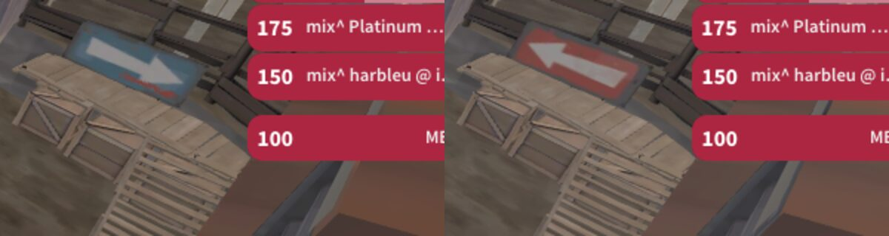
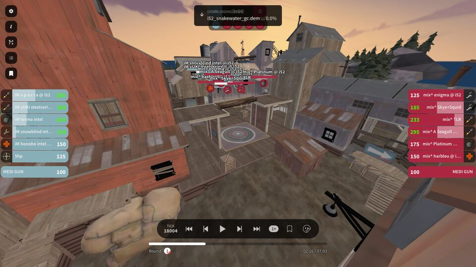
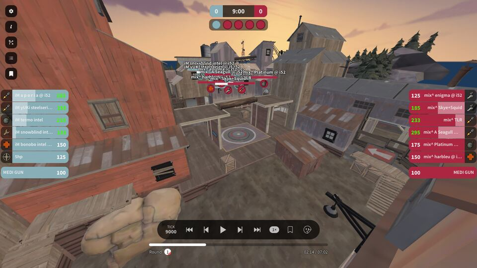
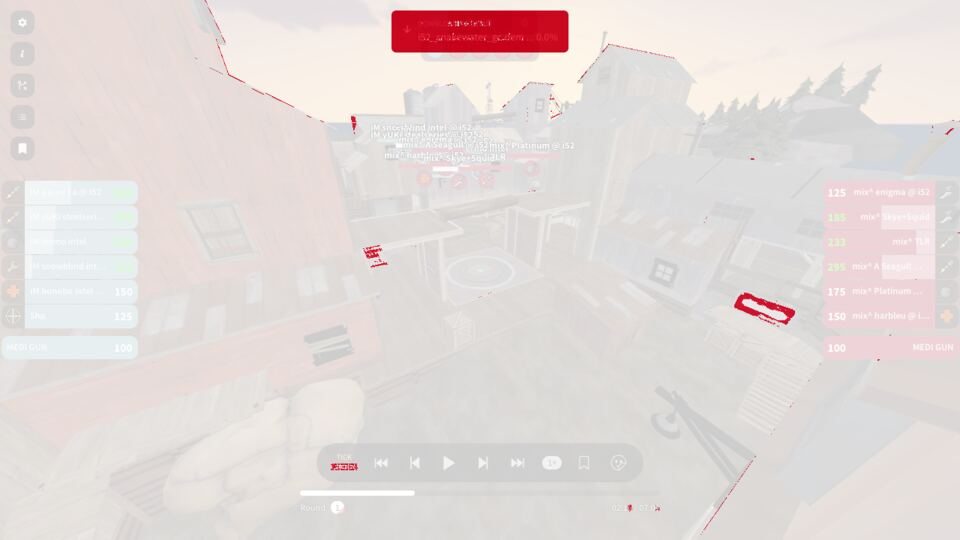
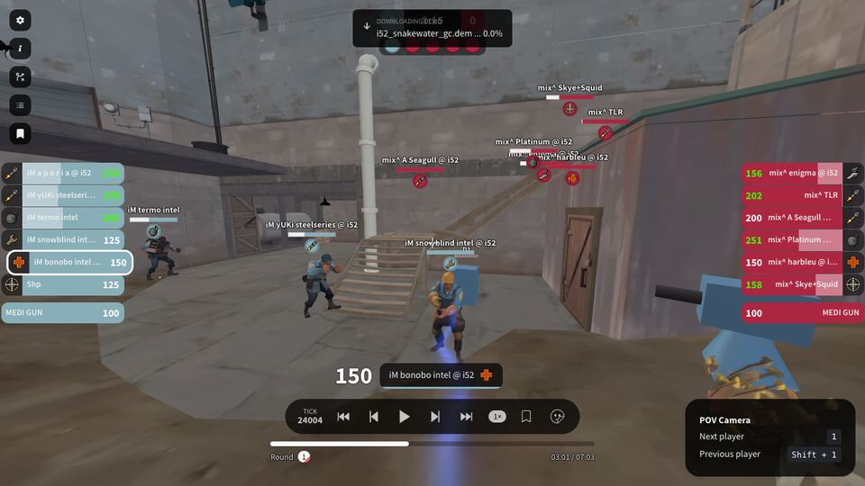
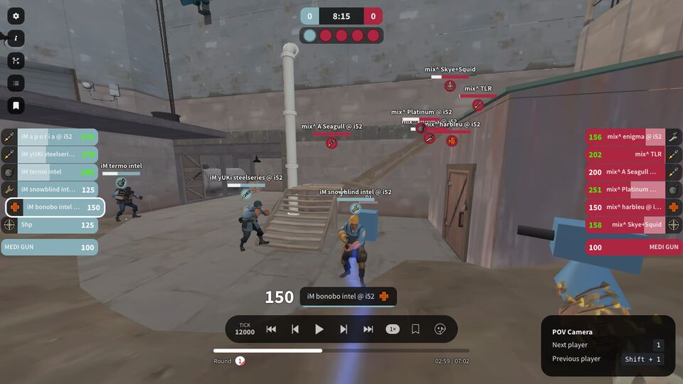
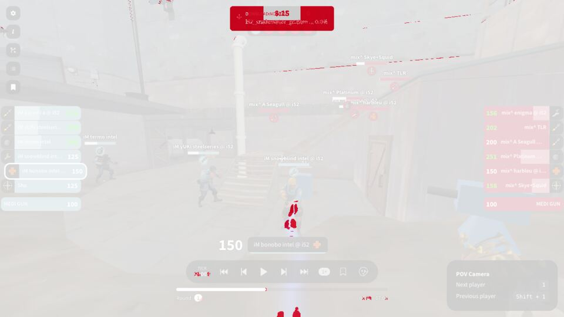

# Match sources, playback in the render loop, world coordinates

dribble.tf's data and playback layers were built around parser2, an older parser: per-player cache classes rebuilt with `Object.setPrototypeOf`, positions relative to a `boundaryMin` that changed with context, and a playback clock outside the render loop that pushed every tick through React. Once stvtf (`decoder/`) became the decoder we own, those shapes only caused costs. They meant 121 React renders of the whole viewer a second, GPU leaks, and four layers of smoothing that patched a timing race. So we retired parser2 and rebuilt the layers around what stvtf gives us.

## Decisions

1. **The viewer reads a match only through `MatchSource`** (`src/components/Analyse/Data/MatchSource.ts`, CONTEXT.md's *match source*). `DemoSource` and `LiveSource` implement it, and neither inherits from the other. Sources answer *fractional* ticks by interpolating between the ticks around them. parser2 and `?decoder=parser2` are gone.
2. **Playback is driven from the render loop.** The clock (`src/utils/playback.ts`) is a fractional tick moved on in the first frame callback (`PlaybackDriver`). That callback reads the match once per frame into `sceneFrame`, and actors and projectiles move their three.js objects directly from it. The store's `playback.tick` follows the clock at most every 50 ms, for the interface. React renders the HUD a few times a second, and each actor only when its look changes (class, team, health, conditions, heal target), never to animate. The 2-tick render delay, `frameProgress`, the stale-frame guard, exponential smoothing and the zero-view-angle fallback are deleted, because they only patched the old clock.
3. **The scene is drawn in world coordinates** (Source units, as the game places things), and the map model sits at its origin. The decoder's output is versioned (`FORMAT = 2`): absolute positions, pitch and yaw only, projectile yaw only, and each array's sampling interval stated in its metadata. The viewer refuses any other format. `PlayerTracks` reads the decoder's arrays directly; the worker sends plain arrays, and `DemoSource` indexes them on the main thread.
4. **Map models are meshopt-compressed with the FILTER method** (`scripts/meshopt-map.mjs`, now a converter step), not the gltf-transform CLI's `meshopt` (QUANTIZE).

## Considered options

- **Keep a 2-tick delay and smoothing, and only stop the React re-renders.** Rejected: both existed only because positions reached the scene through React props a frame late. With the clock in the render loop they add lag and fix nothing. A live match still waits behind its edge, but that already lives in `utils/live.ts` (`lagTicks`).
- **QUANTIZE meshopt** (the CLI default) is smaller per mesh, but it misplaces instanced props. It moves each mesh into a quantized space and adds a node transform to undo that, and the transform lands *outside* `EXT_mesh_gpu_instancing`'s instance transforms. Trees and rocks visibly moved. FILTER left the scene pixel-identical and came out smaller here anyway (Snakewater: 12.6 MB QUANTIZE, 11.7 MB FILTER).
- **Rewriting the per-map RTS centres and saved setups by hand.** Rejected for conversion with each map's `conversion.json`, the frame those values were actually in.

## Consequences

- **Saved data moved frames.** RTS centres saved by viewers go to `settings.scene.worldRtsCenters`; older `rtsCenters` are converted when read and never written. Setups are version 2. Stored version 1 setups and version 1 share links are converted on load (`toWorldSetup`). This also fixes setups captured during a demo, which used to be applied in a different frame.
- **The decoder and the viewer must agree on the format.** Changing `decoder/` means bumping `FORMAT` and `DECODER_FORMAT` (ParseWorker) together, then running `npm run build:decoder`.
- **Intended visual changes:**
  - Opaque map brushes draw front faces only, as `MeshStandardMaterial`. A two-faced sign stops drawing its far face over the near one (below), and thin back-face slivers on some roof edges go.
  - Projectiles turn about z by their yaw, as live matches already did; demos turned them about y.
  - The HUD shows the drawn tick rather than two ahead, and the tick readout is the match's tick, not doubled.
  - Round chips start where play begins, at tick 679 instead of a guessed 300 on the sample demo.

## Verification

`scripts/render-check.mjs` drives a production build in headless Chrome on the real GPU (ANGLE/Metal, Apple M2 Max). It works through `?bench` (`src/utils/bench.ts`), a small surface that stays the same across refactors. The surface seeks to a tick, places the camera in world coordinates, plays, and reads counters. Every step of the refactor was checked against the baseline as it landed. The final figures below come from the baseline (commit 415228e: `dev` plus the harness) and the result, served side by side and run alternately three times. Each cell gives the median and the range. The sample is `i52_snakewater_gc.dem` (7 min, 13 players), and the scenarios are in `0001/scenarios.json`. The raw results of the full runs are in `0001/results-*.json`.

### Rendering

Seven paused shots at fixed ticks and cameras: RTS default, overview, close-up, two POVs, untextured. The table counts pixels differing by more than 10%:

| Shot | Changed | What differs |
|---|---|---|
| 01 default RTS, t800 | 1.66% | the stuck download chip is gone; tick readout; front faces |
| 02 overview, busiest tick | 1.66% | same |
| 03 overview, t9000 | 1.66% | same |
| 04 close-up, t15000 | 1.41% | same |
| 05 POV, t12000 | 1.33% | same, plus the heal beam's animation |
| 06 POV, busiest tick | 1.25% | same |
| 07 untextured, t9000 | 1.45% | same, plus the camera tip panel's timing |

Steps that should not change the picture were checked shot by shot: the match source, world coordinates, and meshopt (0 changed pixels on the map shots).

| Before | After | Difference |
|---|---|---|
|  |  |  |
|  |  |  |

Playback speed is unchanged. Over 8 s it moves 535 ticks at 1× and 1609 at 3×; the baseline moved 536 and 1606.

### Performance

At full speed the M2 Max holds 60 fps either way, with 0 frames over 20 ms in both builds. The CPU-throttled runs (`Emulation.setCPUThrottlingRate`, 4×) show the difference that a slower machine would.

| Metric | Before | After |
|---|---|---|
| React renders of the viewer during playback, /s | 121 | **0** |
| fps, RTS, CPU 4× slower | 22.5 (22.1–23.6) | **37.9** (37.6–38.4) |
| fps, POV, CPU 4× slower | 24.4 (22.8–25.8) | **40.4** (39.0–43.9) |
| p95 frame time, CPU 4× slower, ms | 50.1 | **33.4** |
| Main-thread time outside rendering, RTS, CPU 4×, ms/s | 557 (555–561) | **418** (412–423) |
| Scene draw (`renderer.render`), RTS 1×, ms | 4.4 (4.2–4.6) | **3.3** (3.0–3.4) |
| Scene draw, RTS, CPU 4×, ms | 20.1 (19.2–20.4) | **15.4** (15.4–15.5) |
| JS heap after loading the demo, MB | 36.6 (36.0–37.2) | **25.5** (25.5–26.0) |
| Decoded arrays (players + projectiles), MB | 15.8 | **12.2** |
| Demo ready after navigation, ms | 1783 (1674–2514) | **1496** (1355–1612) |
| Decode in the worker, ms | 644 (622–665) | 580 (577–641) |
| Map models, all 13 | 269 MB | **79 MB** |
| Snakewater model | 44 MB | **11.7 MB** (6 MB gzipped) |

At full speed, "main-thread time outside rendering" is higher after (737 → 803 ms/s). At 60 fps the main thread already reads as about 100% busy in both builds, because waiting on the GPU counts as task time. The throttled runs measure real CPU work.

### GPU memory

Measured with `renderer.info.memory` across 4 scene-mode toggles and 2 round trips to another map:

| | Before | After |
|---|---|---|
| Geometries: start → after mode toggles | 3018 → 5418 | 1097 → 1123 |
| Geometries: after 1st → 2nd map round trip | 6235 → 7088 | 997 → 997 |
| Textures: after 1st → 2nd map round trip | 2437 → 2944 | 439 → 462 |
| JS heap after map switches, MB | 41.2 | 26.5 |

Before, every mode toggle re-downloaded the map and leaked the old model, and every map change leaked about 650 geometries. The model was freed while its `<primitive>` was still in the scene, so it could be drawn and uploaded once more.

## Open items

- **About 10 textures still grow per map load.** Textures reachable from the scene stay at 346 while the renderer's count rises, so some map textures are freed incompletely. Geometries no longer grow. Use `__dribble.textureAudit()` to follow it up.
- **Live matches are not checked by the harness.** `LiveSource` is ported to the interface and to world coordinates, but no stv.tf stream was played in these checks.
- **Map chunk visibility culling is untouched.** It stays switched off in the shipped config; turning it on needs maps reconverted with chunking.
- **The first load of the JS bundle is about the same size.** three.js and React now sit in their own chunks, so app deploys leave them cached. Unused dependencies are gone.
